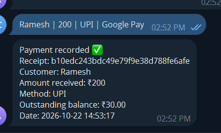
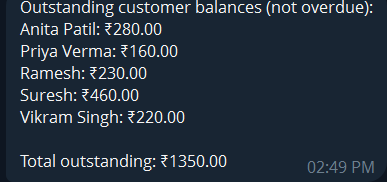

# Shop Assistant AI

> Run sales, stock, and customer khata from one Telegram chat.

Shop Assistant AI is a Python-based Telegram bot concept for small shops. It lets an authorized shopkeeper record sales, purchases, payments, and inventory changes using everyday language, review each operation, and then confirm it before the records are saved to Google Sheets.

## Table of Contents

- [Why Shop Assistant AI?](#why-shop-assistant-ai)
- [Features](#features)
- [Screenshots](#screenshots)
- [How It Works](#how-it-works)
- [Architecture](#architecture)
- [Example Messages](#example-messages)
- [Customer Reminder Flow](#customer-reminder-flow)
- [Tech Stack](#tech-stack)
- [Project Structure](#project-structure)
- [Setup](#setup)
- [Configuration](#configuration)
- [Running the Bot](#running-the-bot)
- [Security and Data Integrity](#security-and-data-integrity)
- [Known Limitations and Next Steps](#known-limitations-and-next-steps)
- [Contributing](#contributing)
- [License](#license)

## Project Screenshots

### Telegram bot interface


### Customer payment receipt


### Customer khata and outstanding credit



## Why Shop Assistant AI?

Small shops often manage stock and customer credit using handwritten registers or memory. This can make it difficult to find old entries, spot low stock, track outstanding balances, and send payment reminders.

Shop Assistant AI aims to make everyday bookkeeping as simple as sending a message.

## Features

- **Natural-language bookkeeping:** Enter transactions in everyday language instead of filling out complex forms.
- **Sales tracking:** Record cash and credit sales after reviewing and confirming the details.
- **Purchase tracking:** Record incoming stock, purchase costs, suppliers, and low-stock limits.
- **Inventory management:** View stock, identify low-stock items, and prepare a reorder list.
- **Customer khata:** Track customer balances, statements, and payments by cash or UPI.
- **Bulk stock entry:** Add inventory items in bulk, with a review step before saving.
- **Customer reminders:** Send reminders only after customers opt in and the shopkeeper reviews and confirms the message.
- **Daily summary:** Review daily sales, collections, purchases, and items sold.
- **Google Sheets storage:** Keep stock and ledger records in a familiar, shareable spreadsheet.
- **Access control:** Restrict shop operations to configured Telegram user IDs.


## Screenshots

The screenshots below show the Telegram bot interface and example bookkeeping responses.

### Telegram bot home and quick actions


The home screen introduces the supported workflows, including sales, stock and inventory, bulk stock entry, customer khata, customer payments, reports, and quick-action buttons.

### Customer payment confirmation


Example receipt for a payment from Ramesh showing the amount received, payment method, remaining outstanding balance, and transaction date.

### Outstanding customer balances


Example list of customer balances and the total outstanding amount. The bot labels these balances as unpaid customer credit, not cash received.

### Outstanding credit summary


Example summary showing total outstanding customer credit and clarifying that the amount is unpaid credit rather than cash received.

> **Note:** These are example screenshots. Names, balances, and transaction details shown are sample data from the supplied images.

## How It Works

1. The shopkeeper sends a message or bot command in Telegram.
2. The bot checks whether the Telegram user is authorized.
3. The bot interprets the request and prepares a summary.
4. The shopkeeper reviews the summary and chooses **Confirm** or **Cancel**.
5. If confirmed, the bot writes the transaction to the ledger and updates stock when applicable.
6. The bot replies with the result.

Cancelled requests should not be saved. If the ledger is written successfully but the stock update fails, the bot warns the shopkeeper to check both sheets before retrying.

## Architecture

```text
Shopkeeper
    |
    v
Telegram App <---------------- Customer (opt-in reminders)
    |
    v
Telegram Bot API
    |
    v
Python Bot
    |-- main.py              Commands, buttons, and confirmations
    |-- config.py            Bot token, authorized IDs, startup checks
    |-- natural_language.py  Interprets everyday messages and bulk input
    |-- sheets.py            Reads and writes Google Sheets
    |
    v
Google Sheets
    |-- Stock
    |-- Ledger
    |-- Customer links
```

## Example Messages

Examples of messages the bot is intended to understand:

| Message | Purpose |
|---|---|
| `Show stock` | View current inventory |
| `Sold 2 kg rice for 120 cash` | Record a cash sale |
| `Sold 1 oil for 150 on credit to Ramesh` | Record a credit sale |
| `Ramesh paid 200 cash` | Record a customer payment |
| `Who owes money?` | Review outstanding customer balances |
| `Reorder list` | Identify items that need replenishment |

The bot should present a confirmation summary before saving supported changes.

## Customer Reminder Flow

1. The shopkeeper runs `/invitecustomer NAME` to generate a one-time linking code.
2. The code is shared privately with the customer.
3. The code expires after 15 minutes and can be used only once.
4. The customer opens the bot and sends `/link CODE`.
5. The shopkeeper runs `/remind NAME`, reviews the reminder, and confirms it.
6. The customer can stop reminders at any time using `/stopreminders`.

Only send reminders to customers who have opted in.

## Tech Stack

- **Language:** Python
- **Bot interface:** Telegram Bot API
- **Data storage:** Google Sheets
- **Configuration:** Environment variables / local environment configuration

The presentation identifies the core technologies above. Exact library versions and deployment-provider requirements depend on the implementation in the repository.

## Project Structure

The main modules described for this project are:

```text
.
├── main.py
├── config.py
├── natural_language.py
├── sheets.py
├── .env.example
├── .gitignore
└── README.md
```

> This is the intended high-level structure based on the project architecture. Keep only files that exist in your repository, and update this section if your actual structure differs.

## Setup

### Prerequisites

Before running the bot, arrange the following:

- Python installed on your system
- A Telegram bot token from [BotFather](https://t.me/BotFather)
- A Google Cloud project with the Google Sheets API enabled
- A Google spreadsheet prepared for the bot's stock and ledger data
- Google credentials with access to that spreadsheet
- Your Telegram user ID for the authorized-user allowlist

### 1. Clone the repository

```bash
git clone <YOUR_REPOSITORY_URL>
cd <YOUR_PROJECT_DIRECTORY>
```

Replace the placeholders with your repository URL and project directory.

### 2. Create and activate a virtual environment

**Windows (PowerShell):**

```powershell
python -m venv .venv
.\.venv\Scripts\Activate.ps1
```

**macOS / Linux:**

```bash
python3 -m venv .venv
source .venv/bin/activate
```

### 3. Install dependencies

If the repository contains a dependency file, install from it:

```bash
pip install -r requirements.txt
```

If `requirements.txt` does not exist, install the dependencies documented by the source code and create a requirements file. Do not assume package names or versions without checking the imports used in your project.

### 4. Configure Google Sheets

1. Enable the Google Sheets API in your Google Cloud project.
2. Create or select the spreadsheet used by the bot.
3. Configure the credentials expected by the project's `sheets.py` module.
4. Grant the configured Google identity access to the spreadsheet.
5. Ensure the required Stock, Ledger, and customer-link data structures match what the code expects.

Follow the authentication method implemented in your code; the exact credential filename and spreadsheet identifier variable may differ.

### 5. Configure environment variables

Create a local `.env` file or configure environment variables in your hosting platform. Use the names expected by `config.py`.

Example template (replace the names with the exact variables used by your code):

```dotenv
TELEGRAM_BOT_TOKEN=your_telegram_bot_token
AUTHORIZED_TELEGRAM_USER_IDS=your_telegram_user_id
LOG_LEVEL=INFO
```

If your implementation uses a Google service-account JSON file or additional spreadsheet settings, configure those separately as required by `sheets.py`.

**Never commit `.env`, bot tokens, private keys, or service-account credentials to GitHub.**

### 6. Start the bot

Run the entry point used by your project. If `main.py` is the configured entry point:

```bash
python main.py
```

Keep the process running and open the bot in Telegram to test it. Hosting is required if the bot must remain online continuously.

## Configuration

| Setting | Purpose |
|---|---|
| `TELEGRAM_BOT_TOKEN` | Authenticates the bot with Telegram |
| `AUTHORIZED_TELEGRAM_USER_IDS` | Restricts shop operations to approved Telegram users |
| `LOG_LEVEL` | Controls application logging verbosity |

These names are based on the project's documented configuration module. Verify the expected format for authorized IDs and any additional settings in `config.py` before running the application.

## Security and Data Integrity

- **Confirm before saving:** Review sales, purchases, payments, adjustments, bulk stock entries, and reminders before committing them.
- **Allowlist access:** Only configured Telegram user IDs should be able to operate the shop.
- **Auditable corrections:** Correct a balance by adding a new ledger entry with a reason rather than editing old entries.
- **Customer privacy:** Use opt-in reminders and allow customers to unsubscribe.
- **Protect credentials:** Keep tokens and service-account secrets out of source control.
- **Back up the spreadsheet:** Maintain regular backups of the Google Sheet.
- **Handle partial failures carefully:** The documented flow writes to the ledger first. If the stock update then fails, inspect both sheets before retrying to avoid duplicate records.

## Known Limitations and Next Steps

The project presentation identifies these possible next steps:

- Persist pending confirmations across bot restarts.
- Host the bot so it stays online all day.
- Back up the Google Sheet regularly.

Additional production-readiness improvements may include automated tests, structured error reporting, duplicate-transaction protection, and recovery procedures for partial Google Sheets writes.

## Contributing

Contributions and suggestions are welcome.

1. Fork the repository.
2. Create a feature branch.
3. Make your changes and test them.
4. Commit with a clear message.
5. Open a pull request describing the change.

Please do not include credentials, customer data, or private spreadsheet contents in commits or issues.

## License

No license was specified in the project presentation. Add a `LICENSE` file and update this section before distributing the project publicly.
