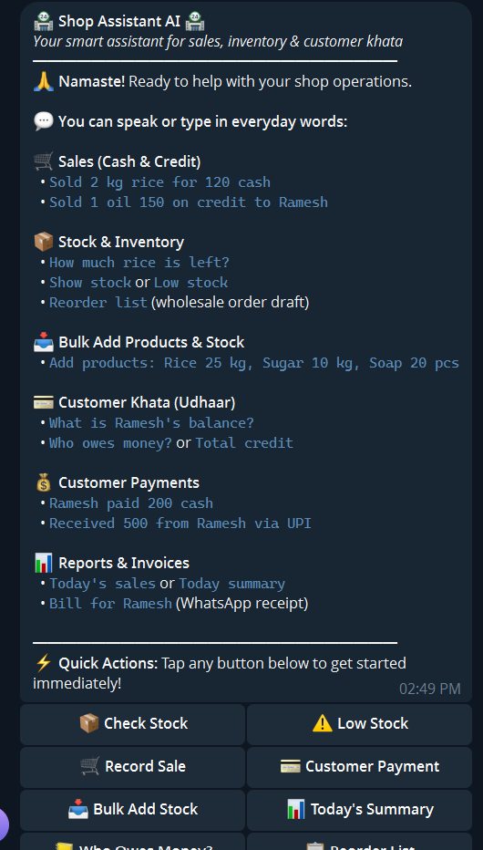
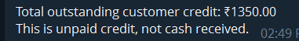

# Small Shop Assistant 🏪🤖

> **Technovision 2026: Zero Syntax** | **Team MINIONS**  
> A transactionally safe, auditable conversational assistant for small retail shops built on **n8n**, **Telegram Bot API**, **n8n Data Tables**, and an append-only **Google Sheets EventJournal**.

[](https://n8n.io)
[](https://telegram.org)
[](https://sheets.google.com)
[](docker-compose.yml)
[](enterprise-postgres/init_schema.sql)
[](LICENSE)

---

## 📸 Interface Preview

| Telegram Interaction | Credit Balance Summary |
|:---:|:---:|
|  |  |
| **Credit Summary & Insights** | **Verified Receipt & Confirmation** |
|  |  |

---

## 📌 Executive Summary

Small kirana and grocery shop owners manage daily credit sales, cash sales, inventory deliveries, and debt repayments informally or via paper khata notebooks. This leads to lost revenue, double-entry errors, forgotten debts, and stock discrepancies.

**Small Shop Assistant** bridges this gap by turning Telegram into an **enterprise-grade, ACID-like retail point-of-sale**. It eliminates accidental commits and double-spending through a strict **6-stage transaction safety lifecycle**:

```
PREPARE ➔ PREVIEW ➔ APPROVAL TOKEN ➔ COMMIT VALIDATION ➔ VERIFIED JOURNAL WRITE ➔ CONFIRMATION
```

### 🛡️ Core Engineering Highlights
- 🔒 **Cryptographically Bound Single-Use Tokens**: Every proposal generates a 16-hex token bound to the SHA-256 payload hash, shop ID, ledger revision, and actor ID (with a 90-second countdown expiry).
- ⚡ **Zero Concurrent Race Windows**: Stamped with execution-unique lock IDs (`LOCKED:<exec_id>`) to prevent duplicate webhook delivery from writing twin records.
- 🚫 **Zero False Successes**: Google Sheets appends are isolated via error-routing (`onError: continueErrorOutput`). If Google Sheets times out or errors, the ledger revision is **never** incremented.
- 📦 **Real-Time Debt & Stock Projections**: Evaluates available stock (`quantity <= current_stock`) and debtor credit limits (`current_debt + amount <= credit_limit`) before staging.
- 📊 **Native Balance & Inventory Queries**: Query individual debtors (`BALANCE Sunita`) or overall store credit (`BALANCE`), and check stock counts (`STOCK Sugar`) or full inventory (`STOCK`).
- 🔄 **Edit & Supersede Flow**: Safely modify in-flight proposals with `EDIT <token> <new command>` which burns the old proposal and generates a fresh approval token.

---

## 🏗️ Architecture & Topology

```
+----------------------------------------------------------------------------------------------------+
|                                    TELEGRAM MESSAGING LAYER                                        |
|                               (Registered Owner: $env.OWNER_TELEGRAM_ID)                           |
+-------------------------------------------------+--------------------------------------------------+
                                                  | Webhook (POST update)
                                                  v
+----------------------------------------------------------------------------------------------------+
|                                      SSA-01-Telegram-Intake                                        |
|  - Verify Owner Telegram ID                                                                        |
|  - Universal Deduplication (ssa_processed_updates)                                                 |
|  - Deterministic Command Parser (COMMIT / CANCEL / EDIT / SALE / CREDIT / REPAY / STOCK / QUERY)   |
+--------+--------------------------+------------------------------+--------------------+------------+
         |                          |                              |                    |
         | kind: TRANSACTION        | kind: COMMIT                 | kind: CANCEL/EDIT  | kind: QUERY
         v                          v                              v                    v
+-----------------------+  +-----------------------+  +-----------------------+  +-------------------+
|  SSA-02B-Resolve-and- |  |  SSA-04-Commit-       |  |  SSA-05-Cancel-or-    |  |  Query Handler    |
|  Store-Pending        |  |  Validate-Write       |  |  Edit-Invalidate      |  |  (BALANCE / STOCK |
|                       |  |                       |  |                       |  |   / HELP)         |
| - Validate Schema     |  | - Verify Owner/Format |  | - Verify Token & Owner|  | - Real customer & |
| - Resolve Customer/   |  | - Rebuild Binding Hash|  | - Invalidate Token    |  |   product lookups |
|   Product & Units     |  | - Atomic Token Burn   |  | - If CANCEL: Discard  |  |   from tables!    |
| - Verify Stock/Debt   |  |   (COMMIT_VALIDATING) |  | - If EDIT: Chain to   |  +-------------------+
| - Compute Projections |  | - Lock ID Verification|  |   SSA-02B with fresh  |
| - 16-Hex Crypto Token |  |   (Prevents races!)   |  |   payload & new token |
| - Store in Pending    |  | - Append to Google    |  +-----------------------+
|   (APPROVAL_ISSUED)   |  |   Sheets EventJournal |
| - Return Preview Msg  |  | - Verify Write Result |
+-----------------------+  | - Increment Revision  |
                           | - Update Debt & Stock |
                           |   Projections in DB   |
                           | - Mark COMMITTED      |
                           +-----------------------+
```

---

## 💬 Command Reference Guide

| Command Syntax | Type | Example | Description |
|---|---|---|---|
| `SALE <amount>` | Transaction | `SALE 200` | Cash sale preview with 16-hex approval token |
| `CREDIT <customer> <amount>` | Transaction | `CREDIT Sunita Deshmukh 500` | Credit sale; verifies limit, projects new balance |
| `REPAY <customer> <amount>` | Transaction | `REPAY Sunita Deshmukh 200` | Debt repayment; projects balance reduction |
| `STOCKIN <product> <qty> <unit>` | Transaction | `STOCKIN Sugar 10 kg` | Inbound inventory; increments stock projection |
| `STOCKOUT <product> <qty> <unit>` | Transaction | `STOCKOUT Sugar 2 kg` | Inventory deduction; verifies stock availability |
| `ORDER <customer> \| <item> <qty> <unit>` | Transaction | `ORDER Sunita \| Sugar 5 kg` | Customer order reservation |
| `COMMIT <token>` | Execution | `COMMIT 3a7f8e210b4c9d12` | Burns token, commits to Google Sheets EventJournal |
| `CANCEL <token>` | Invalidation | `CANCEL 3a7f8e210b4c9d12` | Cancels proposal, permanently burns token |
| `EDIT <token> <new command>` | Supersede | `EDIT 3a7f8e210b4c9d12 SALE 250` | Burns old token, generates new draft preview |
| `BALANCE [customer]` | Query | `BALANCE` or `BALANCE Sunita` | Live outstanding debtor balance from database |
| `STOCK [product]` | Query | `STOCK` or `STOCK Sugar` | Live inventory counts and pricing |
| `HELP` | Reference | `HELP` | Returns formatted command cheat sheet |

---

## 🚀 Quick Start (Deploy in 3 Steps)

### Step 1: Clone Repository & Launch n8n

```bash
# Clone the repository
git clone https://github.com/parthdahiphale6363-ui/team-minions.git
cd team-minions

# Copy environment variables
cp .env.example .env

# Launch n8n with 1-click Docker Compose
docker compose up -d
```
Open **`http://localhost:5678`** in your browser.

---

### Step 2: Import Workflows & Seed Data Tables

1. **Import Workflows**:
   - In n8n, navigate to **Workflows ➔ Import from File**.
   - Import all 4 production workflows from [`workflows/production/`](workflows/production/):
     - `SSA-01-Telegram-Intake.json`
     - `SSA-02B-Resolve-and-Store-Pending.json`
     - `SSA-04-Commit-Validate-Write.json`
     - `SSA-05-Cancel-or-Edit-Invalidate.json`

2. **Initialize Data Tables with Templates**:
   - Create the 5 required n8n Data Tables and import the ready-to-use CSV files from [`data-templates/`](data-templates/):
     - `ssa_customers` ➔ [`data-templates/ssa_customers.csv`](data-templates/ssa_customers.csv)
     - `ssa_products` ➔ [`data-templates/ssa_products.csv`](data-templates/ssa_products.csv)
     - `ssa_ledger_state` ➔ [`data-templates/ssa_ledger_state.csv`](data-templates/ssa_ledger_state.csv)
     - `ssa_pending_proposals` ➔ [`data-templates/ssa_pending_proposals.csv`](data-templates/ssa_pending_proposals.csv)
     - `ssa_processed_updates` ➔ [`data-templates/ssa_processed_updates.csv`](data-templates/ssa_processed_updates.csv)

3. **Set Up Google Sheets EventJournal**:
   - Create a Google Sheet named **`Small_Shop_Assistant_Journal`** with a tab named **`EventJournal`**.
   - Paste the header columns from [`data-templates/GoogleSheets_EventJournal_Template.csv`](data-templates/GoogleSheets_EventJournal_Template.csv).

---

### Step 3: Link Credentials & Activate

1. In n8n **Credentials**, add:
   - **Telegram API**: Add token from [@BotFather](https://t.me/BotFather).
   - **Google Sheets OAuth2**: Connect your Google account.
2. In `.env` (or workflow settings), set:
   - `OWNER_TELEGRAM_ID`: Your personal numeric Telegram user ID (from [@userinfobot](https://t.me/userinfobot)).
3. Activate **`SSA-01-Telegram-Intake`**.
4. Open your Telegram bot and send: `STOCK` or `SALE 100`!

---

## 📂 Repository Directory Layout

```
team-minions/
├── README.md                                    # Master project documentation
├── LICENSE                                      # MIT License
├── docker-compose.yml                           # 1-click n8n self-hosting environment
├── .env.example                                 # Environment variable template
├── .gitignore                                   # Standard ignores for credentials and temp files
│
├── workflows/                                   # Verified production & test workflows
│   ├── production/                              # Hardened, audited production workflows
│   │   ├── SSA-01-Telegram-Intake.json          # Entry webhook, auth filter, dedupe, queries
│   │   ├── SSA-02B-Resolve-and-Store-Pending.json # Stock/debt validation, projections, crypto tokens
│   │   ├── SSA-04-Commit-Validate-Write.json    # Concurrency-locked commit & Google Sheets append
│   │   └── SSA-05-Cancel-or-Edit-Invalidate.json# Token burning & re-proposal chaining
│   ├── testing-harness/                         # Standalone test harnesses
│   │   ├── SSA-02-Prepare-Preview-Harness.json  # Offline preview validator
│   │   └── SSA-03-Issue-Approval-Token-Harness.json # Standalone token issuer
│   └── full-flow/                               # All-in-one / Monolithic workflow exports
│       ├── FULL_FLOW_1.json                     # 103-node combined master workflow
│       └── FULL_FLOW_PART_2.json                # Secondary subflow export
│
├── data-templates/                              # Ready-to-import table schemas and seed datasets
│   ├── ssa_customers.csv                        # Sample kirana store customers with credit limits
│   ├── ssa_products.csv                         # Sample inventory items with stock & pricing
│   ├── ssa_ledger_state.csv                     # Ledger state tracking revision & journal ID
│   ├── ssa_pending_proposals.csv                # Schema for pending proposals
│   ├── ssa_processed_updates.csv                # Schema for update deduplication
│   └── GoogleSheets_EventJournal_Template.csv   # Exact columns & sample rows for Google Sheets
│
├── screenshots/                                 # Interface & Live Demo Screenshots
│   ├── telegram-home.png
│   ├── outstanding-balances.png
│   ├── outstanding-credit-summary.png
│   └── payment-receipt.png
│
├── docs/                                        # Deep-dive Engineering Documentation
│   ├── ARCHITECTURE.md                          # Detailed 6-stage lifecycle, circuit breakers, security
│   ├── TESTING_GUIDE.md                         # 20-scenario adversarial test suite & demo script
│   └── AUDIT_REPORT.md                          # Concurrency & race condition adversarial audit findings
│
├── enterprise-postgres/                         # ACID-Compliant PostgreSQL Migration Option
│   └── init_schema.sql                          # Postgres DDL & commit_transaction stored procedure
│
├── tests/                                       # Automated test payloads
│   └── test_payloads.json                       # Mock Telegram webhook payloads
│
└── Small_Shop_Assistant_Prompt_Pack.md          # Team MINIONS prompt pack
```

---

## 🛡️ Adversarial Audit & Structural Fixes

During our adversarial security audit, four major system-level vulnerabilities were identified and resolved in the production workflows:

| # | Vulnerability Identified | Production Fix Implemented | File Reference |
|---|---|---|---|
| **1** | **Concurrent Commit Race**: Twin webhooks with the same token caused dual Google Sheets writes | Implemented `exec_lock_id` with atomic reservation. Competitor aborted with `CONCURRENT_COMMIT_RACE_LOST`. | [`docs/AUDIT_REPORT.md`](docs/AUDIT_REPORT.md#1-vulnerability-1-concurrent-commit-race-condition) |
| **2** | **False Success on Sheets Outage**: Google Sheets API 500/timeout falsely marked transactions `COMMITTED` | Configured `onError: continueErrorOutput`. Route diverts to `Mark WRITE_FAILED`; revision is never incremented. | [`docs/AUDIT_REPORT.md`](docs/AUDIT_REPORT.md#2-vulnerability-2-false-success-on-google-sheets-outage--timeout) |
| **3** | **Stale Projections**: Debt & stock numbers remained un-updated in Data Tables after commit | Added direct customer debt and inventory stock adjustment nodes in `SSA-04`. | [`docs/AUDIT_REPORT.md`](docs/AUDIT_REPORT.md#3-vulnerability-3-stale-in-memory-projections-post-commit) |
| **4** | **Static Placeholder Queries**: `BALANCE` & `STOCK` returned static "look at Google Sheets" text | Added real Data Table lookups in `SSA-01` providing individual and aggregate shop statistics. | [`docs/AUDIT_REPORT.md`](docs/AUDIT_REPORT.md#4-vulnerability-4-non-functional-balance-and-stock-commands) |

---

## 🧪 20-Scenario Test Suite & Live Demo

The repository contains an exhaustive 20-scenario verification matrix covering schema validation, edge cases, expiry limits, and race conditions.

For the full test matrix and step-by-step hackathon live demo script:
👉 **See [docs/TESTING_GUIDE.md](docs/TESTING_GUIDE.md)**

---

## 🏛️ Enterprise ACID: PostgreSQL Migration Blueprint

For deployments requiring enterprise-grade ACID transactions (preventing partial failures if n8n crashes mid-execution), use the pre-built PostgreSQL migration:

1. Execute [`enterprise-postgres/init_schema.sql`](enterprise-postgres/init_schema.sql) in your PostgreSQL or Supabase instance.
2. In `SSA-04`, replace the separate Data Table and Google Sheets nodes with a single PostgreSQL node executing:
   ```sql
   SELECT ssa.commit_transaction(
     p_event_id => $1,
     p_token_hash => $2,
     p_exec_lock_id => $3,
     p_journal_entry => $4::jsonb
   );
   ```
This provides row-level pessimistic locking (`FOR UPDATE`) and atomic multi-table commit inside the database engine.

---

## 👥 Team MINIONS

- **Hackathon**: Technovision 2026: Zero Syntax
- **Team**: MINIONS
- **Repository**: [parthdahiphale6363-ui/team-minions](https://github.com/parthdahiphale6363-ui/team-minions)
- **License**: [MIT](LICENSE)
