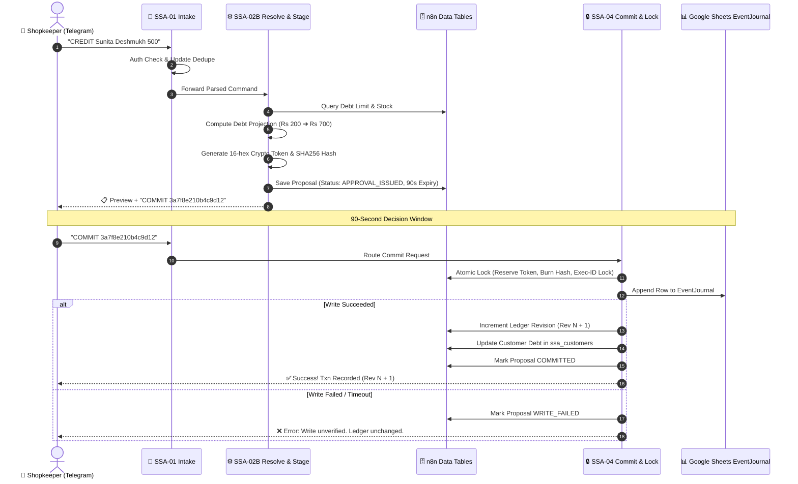

# Small Shop Assistant — Architecture & Security Specification

This document details the internal design, cryptographic safety mechanisms, and distributed consensus principles that power **Small Shop Assistant**.

---

## 1. Core Principles

1. **Explicit Shopkeeper Intent**: No state transition occurs without human approval. Every draft transaction is staged and requires a cryptographically bound token confirmation.
2. **Deterministic Validation**: Inputs are parsed, strictly typed, and verified against real shop tables (inventory stock, credit limits, positive quantities).
3. **Double-Commit and Race Immunity**: Distributed locks prevent concurrent webhook replays from writing duplicate records.
4. **Zero False Positives**: An append to Google Sheets is error-isolated. If the ledger write times out or errors, the revision is never incremented.

---

## 2. Six-Stage Transaction Lifecycle

---

## 3. Cryptographic Token Binding & Single-Use Reservation

Each pending transaction is cryptographically bound to its operational parameters using SHA-256:

$$\text{PayloadHash} = \text{SHA256}(\text{CanonicalSortedJSON}(\text{shop\_id}, \text{event\_type}, \text{customer\_id}, \dots))$$

$$\text{BindingHash} = \text{SHA256}(\text{shop\_id} \parallel \text{event\_id} \parallel \text{ledger\_revision} \parallel \text{payload\_hash} \parallel \text{actor\_id})$$

### Invalidation and Safety Guarantees:
- **90-Second Epoch Window**: Every proposal stores `expires_epoch = $now.toMillis() + 90000`. Any commit attempted after 90 seconds is rejected (`EXPIRED`).
- **Immediate Token Burning**: As soon as a valid commit arrives, `token_hash` is atomically cleared and the status moves to `COMMIT_VALIDATING`. A duplicate or replayed message fails with `TOKEN_NOT_FOUND_OR_ALREADY_USED`.
- **Execution-ID Lock**: To resolve distributed race conditions between two concurrent requests arriving in the same millisecond, `status_reason` is updated with `LOCKED:<execution_id>`. Only the execution whose ID matches proceeds to Google Sheets; the loser aborts with `CONCURRENT_COMMIT_RACE_LOST`.

---

## 4. Circuit Breakers & Safeguards

| Layer | Node Name | Mechanism | Failure Action |
|---|---|---|---|
| **Auth** | `Is Authorized Owner?` | Compares sender ID with `$env.OWNER_TELEGRAM_ID` | Aborts with 403 unauthorized notice |
| **Dedupe** | `Decide Duplicate` | Checks `ssa_processed_updates` for update ID | Skips duplicate or claims with 120s TTL |
| **Schema** | `Validate Fields` | Enforces positive numbers, allowed units, currency | Rejects with human-readable error |
| **Business** | `Resolve References` | Checks `current_debt + amount <= credit_limit` and `quantity <= current_stock` | Returns `PROPOSAL REJECTED: Insufficient stock / Credit limit exceeded` |
| **Ledger** | `Approval Valid?` | Checks uncommitted status, unexpired epoch, binding match | Rejects invalid or tampered commit attempts |
| **Lock** | `Confirm Reservation` | Validates `status_reason == 'LOCKED:' + exec_id` | Rejects concurrent competitor |
| **Journal** | `Append to Sheets` | Uses `onError: continueErrorOutput` | Diverts to `Mark WRITE_FAILED`; revision is never incremented |

---

## 5. Ledger Model (Event Sourcing)

Google Sheets acts as an **append-only immutable EventJournal**. 
- Rows are never edited or deleted.
- If a mistake is made, an explicit compensating transaction (`CANCEL` or reversal) is recorded.
- Every row contains:
  - `event_id`: Unique cryptographic UUID (`EVT-...`)
  - `transaction_id`: Human-readable sequence (`TXN-YYYYMMDD-HHMMSS`)
  - `revision`: Monotonically increasing integer tracking state version
  - `payload_hash`: SHA-256 integrity hash of transaction contents
  - `actor_id`: Sender Telegram ID
